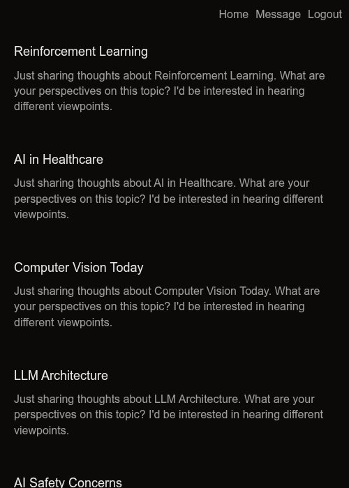
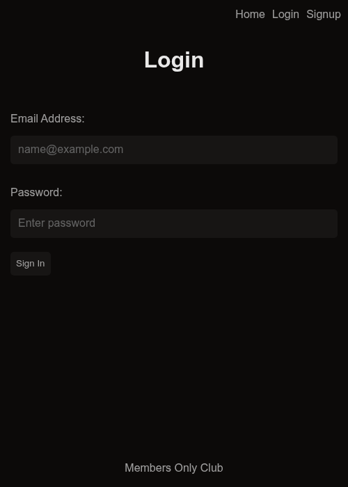
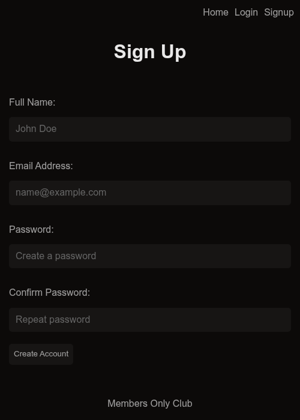
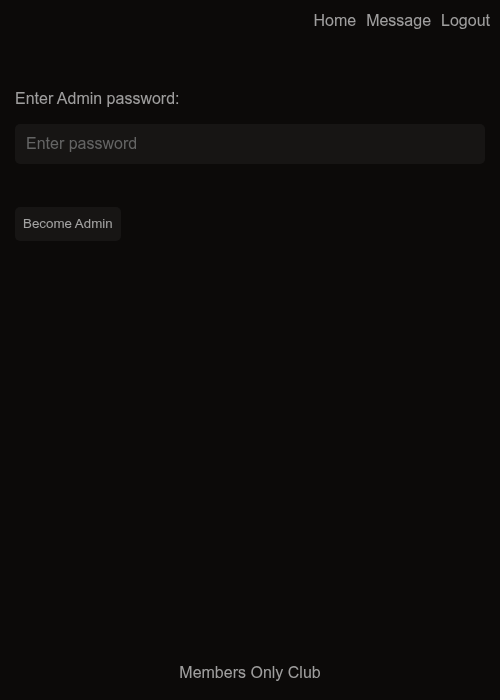

# Odin Members Only

A small Express + EJS members-only message board with Passport authentication. Anyone can read the board, signed-in users can post, only members can see who wrote each message, and only admins can delete messages.

## Setup

Copy the example env file and fill it in:

```bash
cp .env.example .env
```

| Variable | Description |
| --- | --- |
| `DB_URL` | Postgres connection string |
| `SECRET` | Secret used to sign the session cookie |
| `MEMBER_PASSWORD` | Password that promotes an account to member |
| `ADMIN_PASSWORD` | Password that promotes a member to admin |

Create the database tables:

```sql
CREATE TABLE users (
  id            integer GENERATED ALWAYS AS IDENTITY PRIMARY KEY,
  full_name     varchar(255) NOT NULL,
  email         varchar(255) NOT NULL UNIQUE,
  password_hash varchar(255) NOT NULL,
  is_member     boolean NOT NULL DEFAULT false,
  is_admin      boolean NOT NULL DEFAULT false
);

CREATE TABLE messages (
  id         integer GENERATED ALWAYS AS IDENTITY PRIMARY KEY,
  title      varchar(255) NOT NULL,
  text       text NOT NULL,
  created_at timestamptz NOT NULL DEFAULT now(),
  author_id  integer NOT NULL REFERENCES users (id)
);

CREATE TABLE user_sessions (
  sid    varchar NOT NULL PRIMARY KEY,
  sess   json NOT NULL,
  expire timestamp NOT NULL
);

CREATE INDEX "IDX_session_expire" ON user_sessions (expire);
```

## Run

```bash
npm install
npm start
```

```
open http://localhost:3000
```

## Roles

| Role | How to get it | Can |
| --- | --- | --- |
| Guest | None | Read messages (no author or timestamp) |
| User | Sign up | Post messages |
| Member | Enter `MEMBER_PASSWORD` at `/member` | See each message's author and timestamp |
| Admin | Enter `ADMIN_PASSWORD` at `/admin` (members only) | Everything a member can, plus delete messages |

## Pages

| Route | Description |
| --- | --- |
| `GET /` | Message list |
| `GET /login` | Login form |
| `GET /signup` | Sign-up form |
| `GET /message` | New-message form (signed in) |
| `GET /member` | Member-password form (signed in) |
| `GET /admin` | Admin-password form (signed in) |











## Routes

| Method | Path | Description |
| --- | --- | --- |
| GET | `/` | Renders the message list |
| GET | `/login` | Renders the login form |
| POST | `/login` | Authenticates via Passport, then redirects to `/` |
| POST | `/logout` | Logs out, then redirects to `/` |
| GET | `/signup` | Renders the sign-up form |
| POST | `/signup` | Creates an account, then redirects to `/login` |
| GET | `/message` | Renders the new-message form (signed in) |
| POST | `/message` | Adds a message, then redirects to `/` |
| GET | `/member` | Renders the member-password form (signed in) |
| POST | `/member` | Promotes the account to member, then redirects to `/` |
| GET | `/admin` | Renders the admin-password form (signed in) |
| POST | `/admin` | Promotes a member to admin, then redirects to `/` |
| POST | `/deleteMessage` | Deletes a message (admins only), then redirects to `/` |

## curl

Get the message list:

```bash
curl http://localhost:3000/
```

Get the login form:

```bash
curl http://localhost:3000/login
```

Create an account (form fields: `fullname`, `email`, `password`, `confirm_password`):

```bash
curl -X POST http://localhost:3000/signup \
  -H "Content-Type: application/x-www-form-urlencoded" \
  --data "fullname=Golam&email=golam@example.com&password=password123&confirm_password=password123"
```

Log in and save the session cookie:

```bash
curl -c cookies.txt -X POST http://localhost:3000/login \
  -H "Content-Type: application/x-www-form-urlencoded" \
  --data "email=golam@example.com&password=password123"
```

Post a message (signed in):

```bash
curl -b cookies.txt -X POST http://localhost:3000/message \
  -H "Content-Type: application/x-www-form-urlencoded" \
  --data "title=Hello&text=Hello from curl"
```

Become a member (signed in, field: `password`):

```bash
curl -b cookies.txt -X POST http://localhost:3000/member \
  -H "Content-Type: application/x-www-form-urlencoded" \
  --data-urlencode "password=$MEMBER_PASSWORD"
```

Become an admin (members only, field: `password`):

```bash
curl -b cookies.txt -X POST http://localhost:3000/admin \
  -H "Content-Type: application/x-www-form-urlencoded" \
  --data-urlencode "password=$ADMIN_PASSWORD"
```

Delete a message (admins only, field: `message_id`):

```bash
curl -b cookies.txt -X POST http://localhost:3000/deleteMessage \
  -H "Content-Type: application/x-www-form-urlencoded" \
  --data "message_id=1"
```

## Tech

- [Express](https://expressjs.com/) 5
- [EJS](https://ejs.co/) 7
- [Passport](https://www.passportjs.org/) + `passport-local`
- [PostgreSQL](https://www.postgresql.org/) via [`pg`](https://node-postgres.com/)
- [`connect-pg-simple`](https://github.com/voxpelli/node-connect-pg-simple) for session storage
- [`bcryptjs`](https://github.com/dcodeIO/bcrypt.js) for password hashing
- [Helmet](https://helmetjs.github.io/) + [`express-rate-limit`](https://github.com/express-rate-limit/express-rate-limit) for security headers, CSRF, and rate limiting
- Plain CSS (in `views/partials/styles.ejs`), no frontend framework
